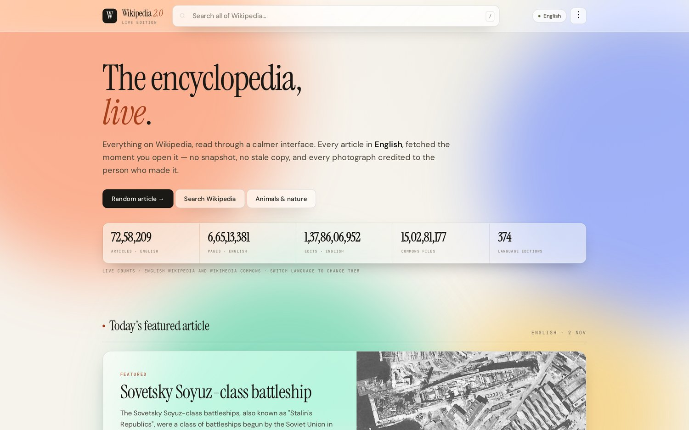
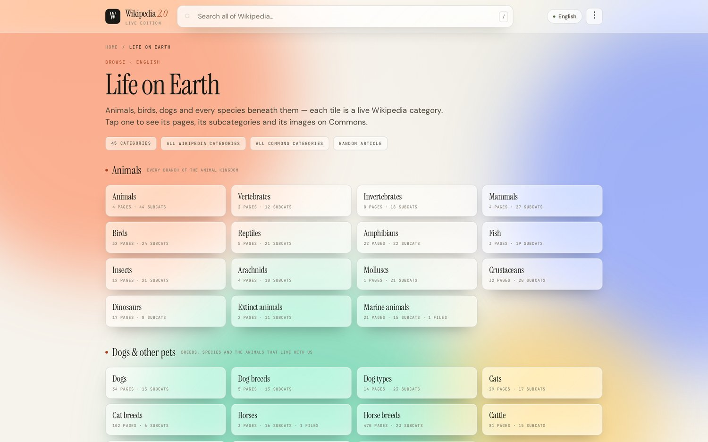
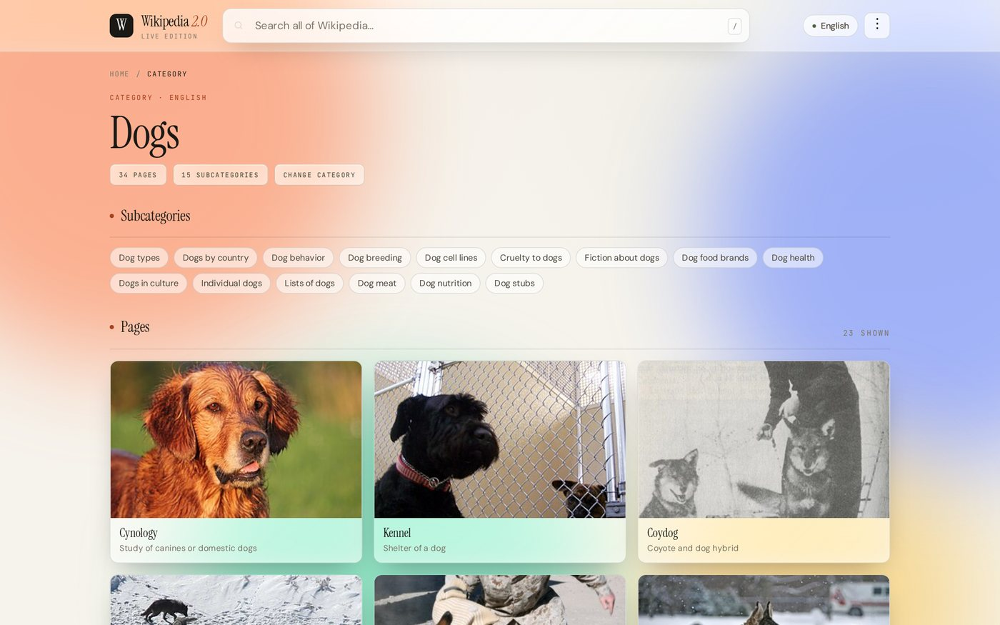
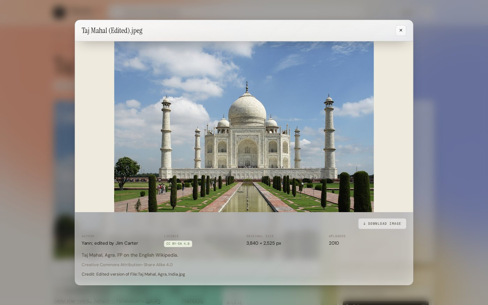
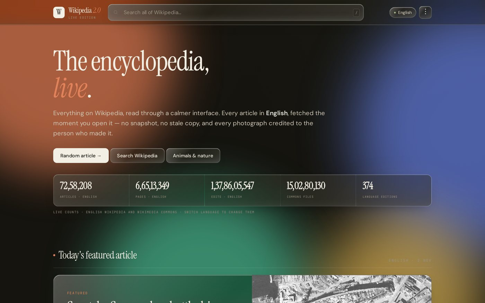

<div align="center">

<a href="https://github.com/technicalnihilist-lgtm/wikipedia-2.0/stargazers"></a>&nbsp;<a href="https://github.com/technicalnihilist-lgtm/wikipedia-2.0/network/members"></a>

<h3>Wikipedia 2.0 — a live reading interface for Wikipedia, web + Android APK</h3>

  

<a href="https://github.com/technicalnihilist-lgtm/wikipedia-2.0/releases/latest"></a>

<b>Support the work</b>

  

<sub>Donations aren't live yet — Paytm, UPI, PayPal and Buy&nbsp;Me&nbsp;a&nbsp;Coffee all show <b>coming soon</b>. Until then, a ⭐ star is the best support.</sub>

<a href="https://github.com/technicalnihilist-lgtm/wikipedia-2.0/releases/latest"></a>  <a href="https://github.com/technicalnihilist-lgtm/wikipedia-2.0/releases"></a>

<h4>Get it from</h4>

<a href="https://github.com/technicalnihilist-lgtm/wikipedia-2.0/releases"></a> <a href="https://github.com/technicalnihilist-lgtm/wikipedia-2.0/archive/refs/heads/main.zip"></a>

</div>

---

---

<p align="center">
  
</p>

<h1 align="center">Wikipedia 2.0</h1>

<p align="center">
  A live reading interface for Wikipedia. Every article, image and category is fetched from the
  Wikimedia APIs the moment you open it — nothing is stored, nothing is pre-downloaded.
</p>

<p align="center">
  <b>Web</b> · <a href="https://technicalnihilist-lgtm.github.io/wikipedia-2.0/">open the app</a> &nbsp;|&nbsp;
  <b>Android</b> · <a href="apk/Wikipedia-2.0.apk">Wikipedia-2.0.apk</a> &nbsp;|&nbsp;
  <b>Windows / macOS / Linux</b> · <a href="desktop/">desktop build</a>
</p>

---

## Runs everywhere

| Platform | How you get it |
|---|---|
| **Web** | [technicalnihilist-lgtm.github.io/wikipedia-2.0](https://technicalnihilist-lgtm.github.io/wikipedia-2.0/) — no install |
| **Windows / macOS / Linux** | **Install as an app** straight from the browser (Chrome/Edge: install icon in the address bar · Safari: Share → Add to Dock). It opens in its own window, with a real icon, and keeps working if the site is offline. |
| **Windows / macOS / Linux** | Native builds from [`desktop/`](desktop/) — `.exe`, `.dmg`, `.AppImage`, `.deb` via Electron. GitHub Actions builds all three on every tag. |
| **Android** | [`apk/Wikipedia-2.0.apk`](apk/Wikipedia-2.0.apk) — 49 KB, signed, Android 5.0+ |

## Screenshots

| Home — live counts follow the language you pick | Article — every photo credited, downloadable |
|---|---|
|  |  |

| Life on Earth — animals, birds, dogs, breeds | A category: subcategories, pages, load more |
|---|---|
|  |  |

| Image viewer — author, licence, size, download | Liquid glass, depth & motion controls |
|---|---|
|  |  |

| Dark theme | Phone |
|---|---|
|  |  |

---

## What it does

- **Search** any article in any of 348 Wikipedia language editions — live.
- **Home** shows today's featured article, picture of the day, most-read, on this day, in the news
  and did-you-know, plus a live count strip (articles · pages · edits · Commons files · editions)
  that changes with the language you select.
- **Articles** render full text, infoboxes, tables and images. Every photograph carries its author
  and licence, a download button, and opens in an in-app file viewer.
- **Edit history** and **what links here** open in-app — that is the CC BY-SA attribution, without
  ever leaving the app.
- **Categories** — browse Wikipedia's root category tree, drill into subcategories, and search every
  category name on Wikipedia *and* Wikimedia Commons.
- **Life on Earth** — animals, birds, dogs, breeds, extinct species and taxonomy, as live categories.
- **Languages** — every open edition; switching reopens the same article in that language, and the
  numbers follow.
- **Liquid glass UI** with 4D tilt, bounce animations, and a panel to tune or switch it all off.

## Android app

`apk/Wikipedia-2.0.apk` — 49 KB, signed (v1 + v2), minSdk 21 (Android 5.0+).

A WebView shell around `index.html` with three additions the browser cannot do:

- **Downloads** go through a JS bridge, so images save straight into your **Downloads** folder
  (MediaStore on Android 10+).
- **Back button** walks the app's own history instead of closing it.
- **Transparent status bar** — the glass header runs behind it, icons follow the light/dark theme.

Sideload it (allow install from unknown sources). It is not on the Play Store.

## Desktop app

`desktop/` is an Electron wrapper around the same `index.html`:

```bash
cd desktop && npm install && npm start     # run it
npm run dist:win                            # .exe installer + portable
npm run dist:mac                            # .dmg + .zip
npm run dist:linux                          # .AppImage + .deb
```

`.github/workflows/desktop.yml` builds all three on GitHub's Windows, macOS and Linux runners on
every `v*` tag, and uploads the installers as artifacts — so you never need all three machines.

## Attribution

Article text is from Wikipedia, written by its volunteer editors, licensed
[CC BY-SA 4.0](https://creativecommons.org/licenses/by-sa/4.0/). Images are from Wikimedia Commons,
each under its own licence — the author and licence are printed under every figure and in the in-app
file viewer. Every article links to its full page history, which is the canonical author list.

This project is **not** affiliated with, endorsed by, or operated by the Wikimedia Foundation.
"Wikipedia" is a trademark of the Wikimedia Foundation, used here descriptively.

## Running the web app

No build step, no dependencies, no API keys. Open `index.html` — it needs an internet connection,
because everything is live. Served over HTTPS it installs as a PWA (`manifest.webmanifest` +
`sw.js`); the service worker caches only the app shell, never an article or an image.

## Building the APK

The APK was built without Gradle, straight from the Android SDK build tools (aapt2, d8, apksig).
`app/build.sh` reproduces it. It is signed with a self-signed key — generate your own before
publishing anywhere:

```bash
keytool -genkeypair -keystore release.p12 -storetype PKCS12 -alias w20 \
  -keyalg RSA -keysize 2048 -validity 10000
```

---

## 🌍 Languages

<sub>Donations are <b>coming soon</b> in every language below — nothing to pay today, nothing to click.</sub>

<div align="center">

<sub><b>हिन्दी · বাংলা · मराठी · తెలుగు · தமிழ் · ગુજરાતી · ಕನ್ನಡ · മലയാളം · ਪੰਜਾਬੀ · ଓଡ଼ିଆ · অসমীয়া · اردو</b></sub>

</div>

<details>
<summary><b>🌍 Open the same message in 53 languages</b></summary>

**🇮🇳 Indian languages**

- **हिन्दी** (Hindi) — ☕ जल्द ही आ रहा है। · ⭐ अगर आपको यह ऐप और हमारा काम पसंद है, तो कृपया रिपॉजिटरी को स्टार दें और हमें फॉलो करें।
- **বাংলা** (Bengali) — ☕ খুব শিগগিরই আসছে। · ⭐ যদি আপনার এই অ্যাপ এবং আমাদের কাজ ভালো লাগে, তবে অনুগ্রহ করে রিপোজিটরিটিকে একটি স্টার দিন এবং আমাদের ফলো করুন।
- **मराठी** (Marathi) — ☕ लवकरच येत आहे. · ⭐ जर तुम्हाला हे ॲप आणि आमचं काम आवडलं असेल, तर कृपया रिपॉझिटरीला स्टार द्या आणि आम्हाला फॉलो करा.
- **తెలుగు** (Telugu) — ☕ త్వరలో రాబోతోంది. · ⭐ మీకు ఈ యాప్, మా పని నచ్చితే, దయచేసి రిపోజిటరీకి ఒక స్టార్ ఇచ్చి మమ్మల్ని ఫాలో అవ్వండి.
- **தமிழ்** (Tamil) — ☕ விரைவில் வருகிறது. · ⭐ உங்களுக்கு இந்த ஆப்பும் எங்க வேலையும் பிடிச்சிருந்தா, தயவுசெஞ்சு இந்த ரெபாசிட்டரிக்கு ஒரு ஸ்டார்…
- **ગુજરાતી** (Gujarati) — ☕ ટૂંક સમયમાં આવી રહ્યું છે. · ⭐ જો તમને આ એપ અને અમારું કામ ગમતું હોય, તો પ્લીઝ રિપોઝિટરીને સ્ટાર આપો અને અમને ફોલો કરો.
- **ಕನ್ನಡ** (Kannada) — ☕ ಶೀಘ್ರದಲ್ಲೇ ಬರುತ್ತಿದೆ. · ⭐ ನಿಮಗೆ ಈ ಆ್ಯಪ್ ಮತ್ತು ನಮ್ಮ ಕೆಲಸ ಇಷ್ಟವಾದರೆ, ದಯವಿಟ್ಟು ರೆಪೊಸಿಟರಿಗೆ ಸ್ಟಾರ್ ಕೊಡಿ ಮತ್ತು ನಮ್ಮನ್ನು ಫಾಲೋ ಮಾಡಿ.
- **മലയാളം** (Malayalam) — ☕ ഉടൻ വരുന്നു. · ⭐ നിങ്ങൾക്ക് ഈ ആപ്പും ഞങ്ങളുടെ പ്രവർത്തനവും ഇഷ്ടപ്പെട്ടെങ്കിൽ, ദയവായി റെപ്പോസിറ്ററിക്ക് ഒരു സ്റ്റാർ…
- **ਪੰਜਾਬੀ** (Punjabi) — ☕ ਜਲਦੀ ਆ ਰਿਹਾ ਹੈ। · ⭐ ਜੇ ਤੁਹਾਨੂੰ ਇਹ ਐਪ ਅਤੇ ਸਾਡਾ ਕੰਮ ਪਸੰਦ ਹੈ, ਤਾਂ ਕਿਰਪਾ ਕਰਕੇ ਰਿਪੋਜ਼ਟਰੀ ਨੂੰ ਸਟਾਰ ਦਿਓ ਅਤੇ ਸਾਨੂੰ ਫਾਲੋ ਕਰੋ।
- **ଓଡ଼ିଆ** (Odia) — ☕ ଖୁବ୍ ଶୀଘ୍ର ଆସୁଛି। · ⭐ ଯଦି ଆପଣଙ୍କୁ ଏହି ଆପ୍ ଏବଂ ଆମର କାମ ଭଲ ଲାଗୁଛି, ତେବେ ଦୟାକରି ରିପୋଜିଟୋରୀକୁ ଗୋଟିଏ ଷ୍ଟାର୍ ଦିଅନ୍ତୁ ଏବଂ ଆମକୁ ଫଲୋ କରନ୍ତୁ।
- **অসমীয়া** (Assamese) — ☕ অতি সোনকালেই আহি আছে। · ⭐ যদি আপুনি এই এপটো আৰু আমাৰ কাম ভাল পায়, তেন্তে অনুগ্ৰহ কৰি ৰিপজিটৰীটোক এটা ষ্টাৰ দিয়ক আৰু আমাক ফ'ল' কৰক।
- **اردو** (Urdu) — ☕ جلد آرہا ہے۔ · ⭐ اگر آپ کو یہ ایپ اور ہمارا کام پسند آئے تو براہ کرم ریپازٹری کو سٹار دیں اور ہمیں فالو کریں۔
- **संस्कृतम्** (Sanskrit) — ☕ शीघ्रमेव आगच्छति।
- **मैथिली** (Maithili) — ☕ जल्दिये आबि रहल अछि।
- **कोंकणी** (Konkani) — ☕ रोखडेंच येता.
- **کٲشُر** (Kashmiri) — ☕ جَلدی یِوان چھُ۔
- **سنڌي** (Sindhi) — ☕ जल्द अची रह्यो आहे।
- **डोगरी** (Dogri) — ☕ जल्दी आ करदा ऐ।
- **ꯃꯤꯇꯩ ꯂꯣꯟ** (Manipuri) — ☕ ꯑꯊꯨꯕꯥ ꯃꯇꯝꯗꯥ ꯂꯥꯛꯀꯅꯤ꯫
- **बर’** (Bodo) — ☕ थाबैनो फैगोन।
- **ᱥᱟᱱᱛᱟᱲᱤ** (Santali) — ☕ ᱞᱚᱜᱚᱱ ᱦᱤᱡᱩᱜ ᱠᱟᱱᱟ᱾
- **नेपाली** (Nepali) — ☕ छिट्टै आउँदैछ। · ⭐ यदि तपाईंलाई यो एप र हाम्रो काम मन पर्‍यो भने, कृपया रिपोजिटरीलाई स्टार दिनुहोस् र हामीलाई फलो गर्नुहोस्।

**🌍 World languages**

- **العربية** (Arabic) — ☕ قريبًا. · ⭐ إذا أعجبك هذا التطبيق وعملنا، فيرجى منح المستودع نجمة ومتابعتنا.
- **简体中文** (Chinese (Simplified)) — ☕ 即将推出。
- **繁體中文** (Chinese (Traditional)) — ☕ 即將推出。
- **Čeština** (Czech) — ☕ Již brzy.
- **Dansk** (Danish) — ☕ Kommer snart.
- **Nederlands** (Dutch) — ☕ Binnenkort beschikbaar. · ⭐ Vind je deze app en ons werk leuk?
- **Filipino** (Filipino) — ☕ Malapit na.
- **Suomi** (Finnish) — ☕ Tulossa pian.
- **Français** (French) — ☕ Bientôt disponible. · ⭐ Si cette application et notre travail vous plaisent, mettez une étoile au dépôt et suivez-nous.
- **Deutsch** (German) — ☕ Bald verfügbar. · ⭐ Wenn dir diese App und unsere Arbeit gefallen, gib dem Repository einen Stern und folge uns.
- **Ελληνικά** (Greek) — ☕ Έρχεται σύντομα.
- **עברית** (Hebrew) — ☕ בקרוב.
- **Magyar** (Hungarian) — ☕ Hamarosan.
- **Bahasa Indonesia** (Indonesian) — ☕ Segera hadir. · ⭐ Jika kamu suka aplikasi ini dan karya kami, beri bintang pada repositori ini dan ikuti kami.
- **Italiano** (Italian) — ☕ In arrivo.
- **日本語** (Japanese) — ☕ 近日公開。 · ⭐ このアプリと私たちの仕事が気に入ったら、リポジトリにスターを付けてフォローしてください。
- **한국어** (Korean) — ☕ 곧 공개됩니다. · ⭐ 이 앱과 저희 작업이 마음에 드신다면 저장소에 스타를 눌러 주시고 팔로우해 주세요.
- **Bahasa Melayu** (Malay) — ☕ Akan datang.
- **Norsk** (Norwegian) — ☕ Kommer snart.
- **فارسی** (Persian) — ☕ به‌زودی.
- **Polski** (Polish) — ☕ Wkrótce. · ⭐ Jeśli podoba Ci się ta aplikacja i nasza praca, daj repozytorium gwiazdkę i obserwuj nas.
- **Português** (Portuguese) — ☕ Em breve.
- **Română** (Romanian) — ☕ În curând.
- **Русский** (Russian) — ☕ Скоро. · ⭐ Если вам нравится это приложение и наша работа, поставьте звёздочку репозиторию и подпишитесь на нас.
- **Español** (Spanish) — ☕ Muy pronto. · ⭐ Si te gusta esta app y nuestro trabajo, dale una estrella al repositorio y síguenos.
- **Kiswahili** (Swahili) — ☕ Inakuja hivi karibuni.
- **Svenska** (Swedish) — ☕ Kommer snart.
- **ไทย** (Thai) — ☕ เร็ว ๆ นี้
- **Türkçe** (Turkish) — ☕ Çok yakında.
- **Українська** (Ukrainian) — ☕ Незабаром.
- **Tiếng Việt** (Vietnamese) — ☕ Sắp ra mắt. · ⭐ Nếu bạn thích ứng dụng này và công việc của chúng tôi, hãy tặng kho lưu trữ một ngôi sao và theo…

</details>

