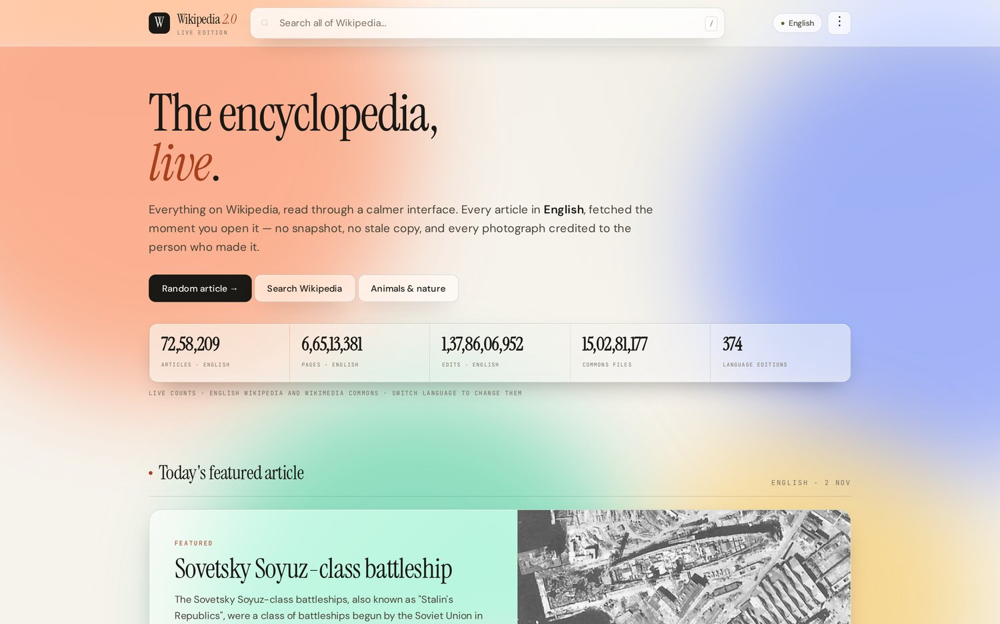
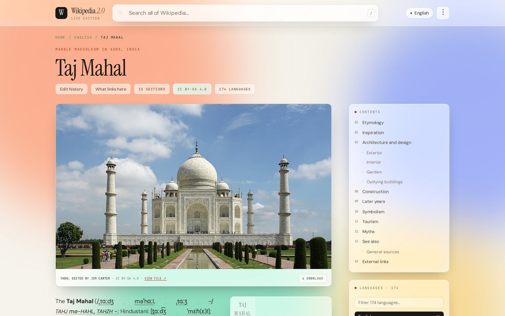
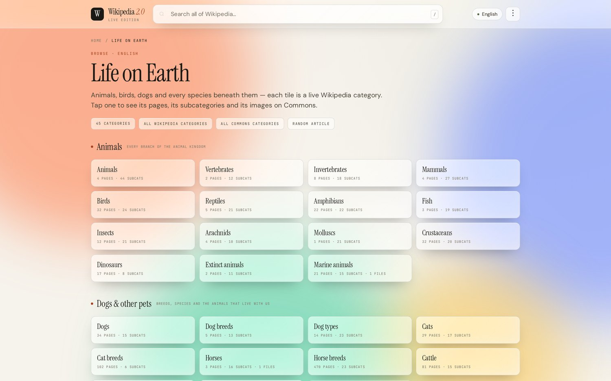
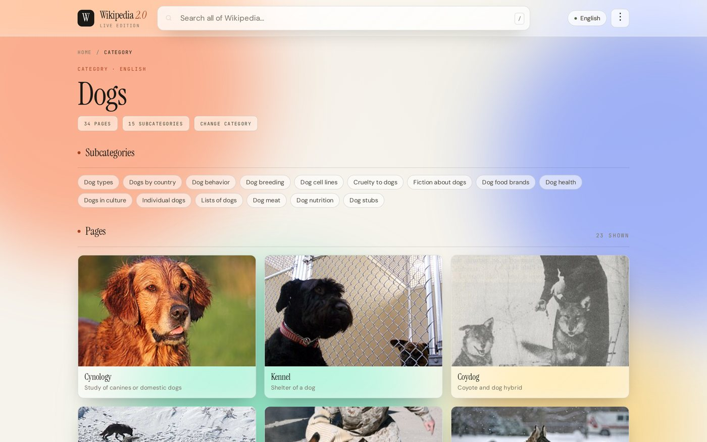
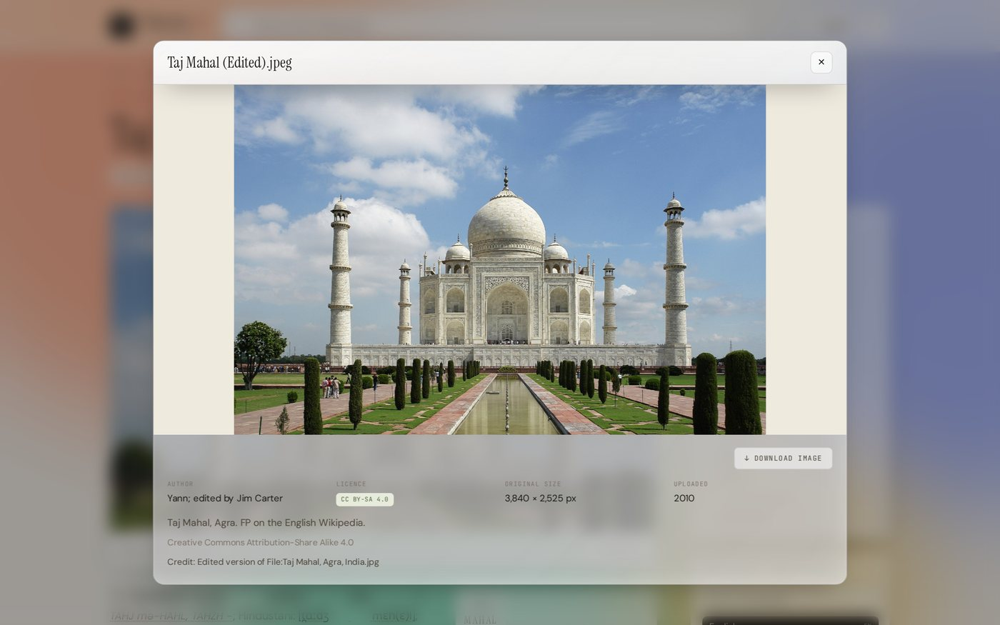
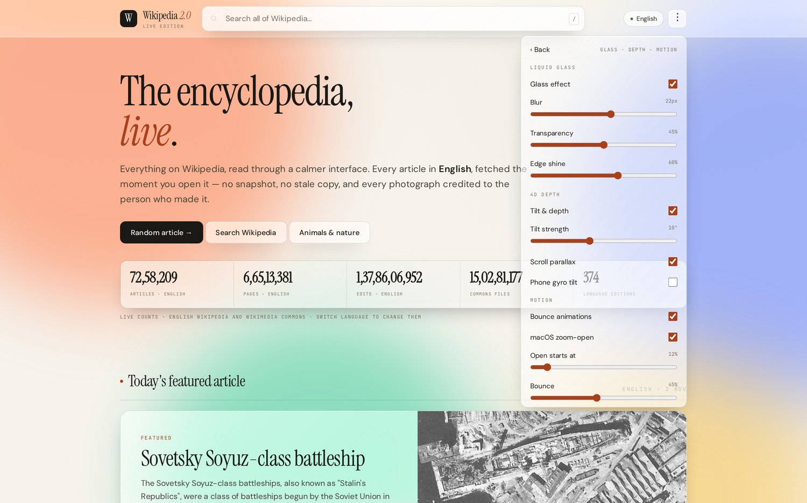
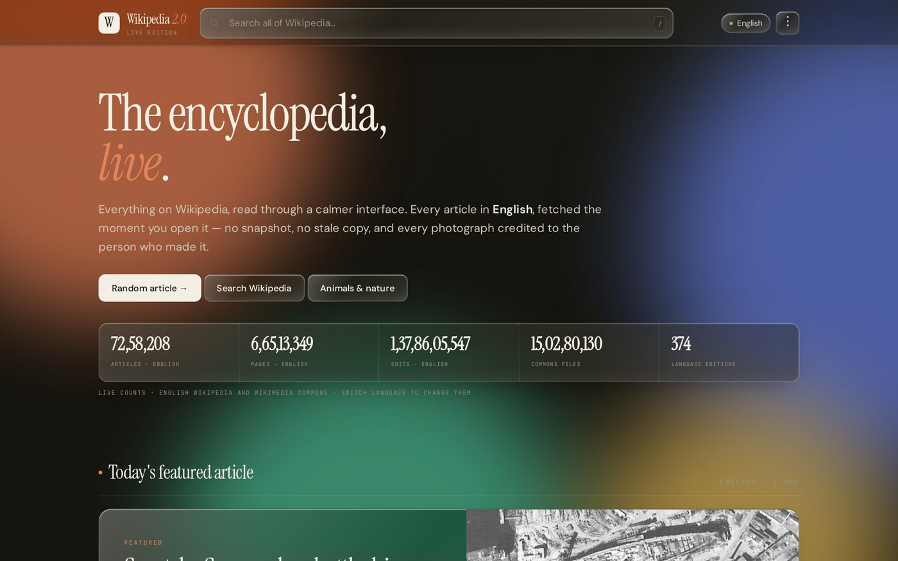
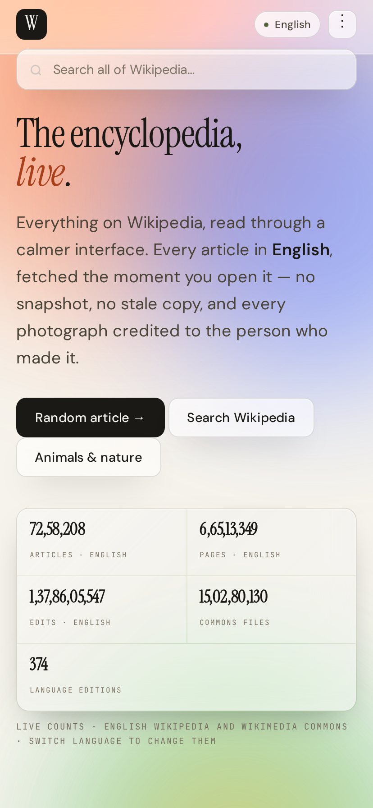

<p align="center">
  
</p>

<h1 align="center">Wikipedia 2.0</h1>

<p align="center">
  A live reading interface for Wikipedia. Every article, image and category is fetched from the
  Wikimedia APIs at the moment you open it — nothing is stored, nothing is pre-downloaded.
</p>

<p align="center">
  <a href="apk/Wikipedia-2.0.apk"><b>⬇ Download the Android APK</b></a> ·
  <a href="index.html">Open the web app</a>
</p>

---

## Screenshots

| Home — live counts follow the language you pick | Article — every photo credited, downloadable |
|---|---|
|  |  |

| Life on Earth — animals, birds, dogs, breeds | A category: subcategories, pages, load more |
|---|---|
|  |  |

| Image viewer — author, licence, size, download | Liquid glass, depth & motion controls |
|---|---|
|  |  |

| Dark theme | Phone |
|---|---|
|  |  |

---

## What it does

- **Search** any article in any of 348 Wikipedia language editions — live.
- **Home** shows today's featured article, picture of the day, most-read, on this day, in the news
  and did-you-know, plus a live count strip (articles · pages · edits · Commons files · editions)
  that changes with the language you select.
- **Articles** render full text, infoboxes, tables and images. Every photograph carries its author
  and licence, a download button, and opens in an in-app file viewer.
- **Edit history** and **what links here** open in-app — that is the CC BY-SA attribution, without
  ever leaving the app.
- **Categories** — browse Wikipedia's root category tree, drill into subcategories, and search every
  category name on Wikipedia *and* Wikimedia Commons.
- **Life on Earth** — animals, birds, dogs, breeds, extinct species and taxonomy, as live categories.
- **Languages** — every open edition; switching reopens the same article in that language, and the
  numbers follow.
- **Liquid glass UI** with 4D tilt, bounce animations, and a panel to tune or switch it all off.

## Android app

`apk/Wikipedia-2.0.apk` — 49 KB, signed (v1 + v2), minSdk 21 (Android 5.0+).

It is a WebView shell around `index.html` with three additions that the browser cannot do:

- **Downloads** go through a JS bridge, so images save straight into your **Downloads** folder
  (MediaStore on Android 10+).
- **Back button** walks the app's own history instead of closing it.
- **Transparent status bar** — the glass header runs behind it, icons follow the light/dark theme.

Sideload it (allow install from unknown sources). It is not on the Play Store.

## Attribution

Article text is from Wikipedia, written by its volunteer editors, licensed
[CC BY-SA 4.0](https://creativecommons.org/licenses/by-sa/4.0/). Images are from Wikimedia Commons,
each under its own licence — the author and licence are printed under every figure and in the in-app
file viewer. Every article links to its full page history, which is the canonical author list.

This project is **not** affiliated with, endorsed by, or operated by the Wikimedia Foundation.
"Wikipedia" is a trademark of the Wikimedia Foundation, used here descriptively.

## Running the web app

No build step, no dependencies, no API keys. Open `index.html` — it needs an internet connection,
because everything is live.

## Building the APK

The APK was built without Gradle, straight from the Android SDK build tools (aapt2, d8, apksig).
`app/build.sh` reproduces it. It is signed with a self-signed key — generate your own before
publishing anywhere:

```bash
keytool -genkeypair -keystore release.p12 -storetype PKCS12 -alias w20 \
  -keyalg RSA -keysize 2048 -validity 10000
```
